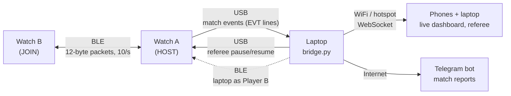

# TinyBoy Arena – Pocket Multiplayer FPS

**ICT1011 Team Exploration Project**

TinyBoy turns the TinyCircuits TinyScreen+ into a pocket-sized retro game console. It runs a first-person 3D maze shooter, in the style of classic raycaster games like Wolfenstein 3D, on a 96×64 OLED screen, controlled with two joysticks (move + look).

Two TinyBoys play **1v1 over Bluetooth Low Energy**, and the match spreads out from there: a **laptop** records every match and can join as a player itself, **phones** watch the match live and act as referee, and a **Telegram bot** posts the results.

Each TinyBoy sits in a 3D-printed mini arcade cabinet designed by the team.

The challenge is fitting a real-time 3D game plus wireless multiplayer into a microcontroller with a 48 MHz processor, about 32 KB of RAM and no floating-point hardware.

## Demo video

▶ **[Watch the demo on YouTube](https://youtu.be/vlQPMvbvyPE)** (2:59): Bluetooth duel, live dashboard on laptop and phone, referee pause, disconnect handling, arena simulation and the Telegram bot.

## Features

**On the watch (`firmware/tinyboy`)**
- **3D raycasting engine:** real-time first-person maze, rendered column by column into a RAM frame buffer (~30–40 FPS)
- **Twin-stick controls:** left joystick moves/strafes, right joystick looks; the gun fires automatically. Menus are fully stick-driven (left stick up/down to choose, right stick to select, left stick left = back)
- **Main menu:** Singleplayer, Multiplayer (Host / Join), Settings (rounds to win: 1 / 3 / 5), How to Play, with sound effects
- **Singleplayer:** play against an on-watch bot that patrols the maze and shoots back
- **1v1 multiplayer over BLE:** two watches exchange position, angle, hits, round and flags 10 times a second
- **Pause:** hold the right stick up for ½ s (or press the BACK button) to pause both watches; Resume / Quit to menu. If the other player or the referee paused, hold the right stick 1.5 s to quit
- **Match end:** YOU WIN / GAME OVER screen, then back to the main menu
- **Robust link:** turn-taking protocol, timeouts for lost packets, raised BLE transmit power and a 4 s link timeout to ride out short dropouts, disconnect detection (the watches re-pair and start a fresh match when back in range), watchdog that recovers a frozen watch

**On the laptop (`laptop/`)**
- **Bridge:** reads the match from the host watch over USB and saves every match to `matches.json`
- **Live web dashboard:** live map, scoreboard, kill feed, round history and match report, on the laptop and on any phone on the same network
- **Referee:** pause / resume both watches from the dashboard (laptop or phone), protected by a host token
- **Telegram bot:** posts an automatic match report and answers `/top`, `/stats`, `/leaderboard`, `/replay`
- **Laptop bot:** the laptop joins a watch as Player B over Bluetooth and plays with a pathfinding AI (easy / normal / hard)
- **Arena server:** server-authoritative Free-for-All for more players (bots), live on the dashboard with full referee controls (pause, restart, match duration)

## How the multiplayer works



- **Each watch runs its own copy of the game.** The watches share no screen and no memory: everything a player knows about the opponent arrives in packets.
- **Watch ↔ watch (BLE):** watch A is the peripheral, watch B the central (Nordic UART service). B sends a packet, A replies (turn-taking, ~10 per second; resend after 300 ms without an answer). Packet layout: [`docs/interfaces.md`](docs/interfaces.md).
- **Who decides a hit:** the shooter. Each watch counts the hits *it* landed; the other side takes its damage from that count, only for the same round number, so both agree on every round.
- **Pause** travels in the packet flags, so pausing one watch freezes both.
- **Watch → laptop (USB):** the host watch prints match events (`EVT,ROUND_START`, `EVT,HIT`, `EVT,POS`, `EVT,ROUND_END`, …). `bridge.py` turns them into `matches.json`, the dashboard and the Telegram reports.
- **Laptop → watch (USB):** the dashboard's referee button sends `CMD,PAUSE` / `CMD,RESUME` to the host watch, which pauses the duel for both players.
- **Laptop as a player (BLE):** `server/watch_link.py` speaks the same protocol as watch B, so the laptop can join a real watch as an AI opponent.

## Hardware

Per console:

| Component | Purpose |
|---|---|
| TinyScreen+ | Processor (SAMD21, 48 MHz) + 96×64 OLED + 4 side buttons |
| ST BLE TinyShield (BlueNRG-MS) | Watch-to-watch multiplayer and the laptop link |
| Wireling Adapter TinyShield | Connects the Wirelings below |
| 2 × Joystick Wireling | Movement (port 0, left) and looking (port 3, right) |
| Buzzer Wireling | Sound effects (port 1) |
| 150 mAh Li-Po battery (502020) | Portable power |
| 3D-printed mini arcade cabinet | Case designed by the team in CAD: screen window, two stick holes, BACK button plunger, USB opening at the back |

Laptop: any Windows/macOS/Linux laptop with Python 3.10+ and Bluetooth (for the laptop bot).

## Repository structure

```
firmware/tinyboy/    Main game sketch (open tinyboy.ino in the Arduino IDE)
experiments/         Standalone test sketches (FPS test, raycaster versions, BLE tests, duel_v1-v3)
laptop/              Bridge, live dashboard server, Telegram bot, database, replay/heatmap tools
laptop/server/       Arena server, bots, laptop-as-Player-B (watch_link.py), arena on the dashboard
web/                 Live web dashboard (spectator + referee), served by the laptop
case/                3D-printable cabinet files
docs/                Interface definitions (packets, events, JSON) and attributions
```

## Getting started

### 1. Watches
1. Install the [Arduino IDE](https://www.arduino.cc/en/software) and the TinyScreen+ board support (TinyCircuits setup guide on [tinycircuits.com](https://tinycircuits.com/)).
2. Install the TinyScreen, STBLE, Wireling and SX1505 libraries.
3. Open `firmware/tinyboy/tinyboy.ino`, select the TinyScreen+ board and its port, and upload to **both** watches.

**Controls:** left stick = move / strafe, right stick = look, gun fires automatically. Hold the right stick up = pause (the top-left BACK button also works). In the menu: left stick up/down to choose, right stick to select, left stick left = back. On the waiting and round-over screens, hold the left stick left for 1 s to return to the menu.

If your cabinet mounts the board the other way round, change `SCREEN_FLIP`, `MOVE_PORT` / `TURN_PORT` and `JOY_SWAP_*` at the top of `tinyboy.ino`.

### 2. Laptop
```powershell
cd laptop
pip install -r requirements.txt
```
For Telegram, create `laptop/.env` with `TELEGRAM_TOKEN`, `TELEGRAM_CHAT_ID` (and `TELEGRAM_THREAD_ID` for a topic). Never commit this file. Full details: [`laptop/README.md`](laptop/README.md).

### 3. Play

**Watch vs watch** (watch A on USB, e.g. COM5):
1. Watch A: MULTIPLAYER → HOST (A). Watch B: MULTIPLAYER → JOIN (B).
2. Terminal 1: `python bridge.py --port COM5 --name-a Alice --name-b Bob --live --host-token <password>`
3. Terminal 2: `python bot.py`
4. Open `http://localhost:8000/` (phones: `http://<laptop IP>:8000/`), enter the host token to use the referee.

**Watch vs laptop bot** (Bluetooth, no USB needed):
1. Watch B off. Watch A: MULTIPLAYER → HOST (A).
2. `python bridge.py --laptop-bot --name-a You --name-b "Laptop bot" --live` (harder bot: `--bot-args "--difficulty hard"`)

**Arena** (simulation, no watches):
`python -m server.arena_live --host-token <password>`, then open `http://localhost:8000/`.

**Without hardware:** `python bridge.py --replay sample/events.log --data my_test --live` replays a recorded match on the dashboard.

**Network:** the laptop and phones must be on the same network. We use a phone hotspot. On Windows, set the network to *Private* so phones can reach the dashboard.

## Benchmarks

| Test | Result | Notes |
| --- | --- | --- |
| `experiments/fps_test` | **194 FPS** | Full 96×64 screen redraw, 8-bit colour, line-by-line `writeBuffer` (~5 ms per frame) |
| `experiments/raycaster_v1` | **~50 FPS** | Walls-only raycaster, `float` maths, 96 rays per frame |
| `experiments/raycaster_v2` | **~29–43 FPS** | Adds opponent sprite (hidden behind walls) + crosshair hit check; dips when the sprite fills more of the screen |
| `experiments/duel_v1` | **~35 FPS** | 2-player duel over BLE (watch ⇄ watch), 10 packets/s with turn-taking, auto-restart watchdog |
| Laptop bot link test | **0 bad packets** | Laptop as Player B over BLE: 660 packets sent, 659 answered in one round |

## Known limitations

- Two players per match on the watches; the Arena (more players) currently runs as a simulation with server bots.
- BLE range is a few metres indoors; walls, bodies and a covered antenna shorten it. Out of range, the match is aborted (saved as a partial match) and the watches re-pair automatically.
- Only finished matches are posted to Telegram; aborted matches are saved but not announced.
- In watch-vs-laptop-bot mode the referee pause is not available (it travels over USB); players can still pause with the BACK button.
- Facing direction on the dashboard is estimated from movement (the duel packet does not send it to the laptop).
- If both players land their winning hit at almost the same moment and a packet is lost, the two watches can disagree on that round (rare).

## Team

| Member | Software | Hardware / 3D print | Video |
|---|---|---|---|
| Morikage Shinji (2604696) | Team lead. Raycasting engine, BLE watch-to-watch multiplayer, firmware integration (menu + bot + duel + pause), laptop bridge, live dashboard server, referee, laptop-bot and arena dashboard integration | Measured the TinyScreen+ stack, CAD design of the cabinet, cabinet firmware changes (screen flip, stick mapping, stick pause) | Storyboard and script, dashboard recordings, Caster 2 voiceover |
| Lee Chee Hsien (2603040) | Telegram bot (first version) | – | Segment edit |
| Muhammad Naufal (2603036) | Arena server (rules, bots, pathfinding, packet protocol), laptop as Player B over BLE (`watch_link.py`, `duel_bot.py`) | Cabinet and watch assembly | Architecture animation |
| Jeremy Ang (2603019) | Live web dashboard (`web/index.html`): spectator view, scoreboard, kill feed, referee panel, duel/phone polish | – | Intro and outro |
| Tee Wei Wen (2605749) | Telegram bot features and match reports, SQLite database, replay GIFs, heatmaps | – | Segment edit |
| Lee Yu Xuan (2603945) | Menu UI and sound effects (`sound.cpp`) | Cabinet and watch assembly | Final video edit |

## Contributing

- Don't push directly to `main`. Create a branch for your work and open a Pull Request.
- Pull from `main` often to stay up to date.
- Any code adapted from online sources **must** be credited in [`docs/ATTRIBUTION.md`](docs/ATTRIBUTION.md) and in a comment in the source file.

## Attribution

See [`docs/ATTRIBUTION.md`](docs/ATTRIBUTION.md) for all third-party code, libraries and references used.
